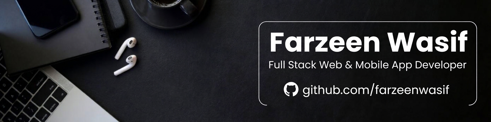

<!-- ═══════════════════════════ HEADER ═══════════════════════════ -->
<p align="center">
  
</p>

<p align="center">
  <a href="https://git.io/typing-svg">
    
  </a>
</p>

<p align="center">
  <a href="https://www.linkedin.com/in/farzeen-wasif"></a>
  <a href="https://farzeensportfolio.vercel.app"></a>
  <a href="mailto:farzeenwasif15@gmail.com"></a>
  
</p>


<!-- ═══════════════════════════ ABOUT ═══════════════════════════ -->
##  &nbsp;About Me


```typescript
const farzeen = {
  role:      "Full Stack Web & Mobile Developer",
  frontend:  ["React", "Next.js", "TypeScript", "Tailwind"],
  mobile:    ["React Native", "Expo"],
  backend:   ["Node.js", "Express", "MongoDB", "Firebase"],
  motion:    ["Framer Motion", "GSAP", "Three.js"],
  focus:     "clean architecture · performance · polished UI/UX",
  currently: "shipping animated, scalable products 🚀",
};
```

- 🔭 Building modern web and mobile applications with clean architecture and performance in mind
- 🎨 Passionate about animated interactions, micro-motion, and 3D on the web
- 📱 React Native (Expo) apps focused on smooth, responsive layouts
- 🌱 Always exploring the React ecosystem and modern frontend animation techniques

<br clear="right"/>


<!-- ═══════════════════════════ TECH STACK ═══════════════════════════ -->
##  &nbsp;Tech Stack

<table align="center" width="100%">
  <tr>
    <td align="center" width="50%">
      <h3>🎨 Frontend</h3>
      <a href="https://skillicons.dev"></a>
    </td>
    <td align="center" width="50%">
      <h3>⚙️ Backend</h3>
      <a href="https://skillicons.dev"></a>
    </td>
  </tr>
  <tr>
    <td align="center">
      <h3>📱 Mobile</h3>
      <a href="https://skillicons.dev"></a>
      <br/><sub>React Native · Expo Go</sub>
    </td>
    <td align="center">
      <h3>💅 UI Styling</h3>
      <a href="https://skillicons.dev"></a>
    </td>
  </tr>
  <tr>
    <td align="center">
      <h3>✨ Animation &amp; 3D</h3>
      <a href="https://skillicons.dev"></a>
      
      
    </td>
    <td align="center">
      <h3>🛠️ Tools</h3>
      <a href="https://skillicons.dev"></a>
    </td>
  </tr>
</table>


<!-- ═══════════════════════════ STATS ═══════════════════════════ -->
##  &nbsp;GitHub Analytics

<p align="center">
  
  
</p>

<p align="center">
  
</p>

<p align="center">
  
</p>

<p align="center">
  
</p>


<!-- ═══════════════════════════ SNAKE ═══════════════════════════ -->
##  &nbsp;Contribution Snake

<p align="center">
  <picture>
    <source media="(prefers-color-scheme: dark)" srcset="https://raw.githubusercontent.com/farzeenwasif/farzeenwasif/output/github-snake-dark.svg"/>
    <source media="(prefers-color-scheme: light)" srcset="https://raw.githubusercontent.com/farzeenwasif/farzeenwasif/output/github-snake.svg"/>
    
  </picture>
</p>


<!-- ═══════════════════════════ CONTACT ═══════════════════════════ -->
##  &nbsp;Let's Connect

<p align="center">
  <a href="https://www.linkedin.com/in/farzeen-wasif"></a>&nbsp;
  <a href="https://farzeensportfolio.vercel.app"></a>&nbsp;
  <a href="mailto:farzeenwasif15@gmail.com"></a>
</p>

<p align="center">
  <i>Open to collaborations, freelance work, and interesting problems.</i>
</p>

<!-- ═══════════════════════════ FOOTER ═══════════════════════════ -->


<p align="center">
  
</p>
