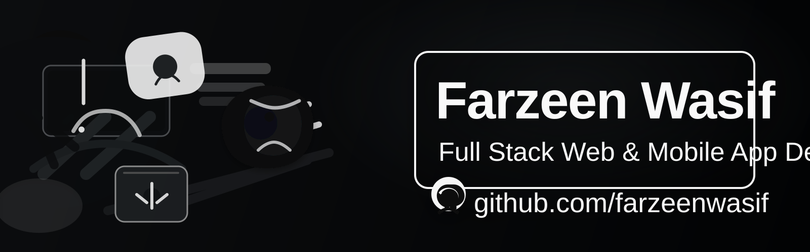

<!-- ───────────────────────────── HEADER ───────────────────────────── -->

  

  

  
  &nbsp;
  
  &nbsp;
  
  &nbsp;
  

 

<!-- ───────────────────────────── ABOUT ───────────────────────────── -->
<table border="0" cellspacing="0" cellpadding="0" width="100%">
<tr>
<td width="62%" valign="top">

## About me

Full Stack developer focused on building modern web and mobile applications with clean architecture, performance optimization, and polished UI/UX. Experienced in developing responsive interfaces, animated interactions, and scalable backend APIs.

- 🔭 &nbsp;**Web** — React, Next.js and TypeScript, backed by Node, Express, MongoDB and Firebase
- 📱 &nbsp;**Mobile** — React Native (Expo) apps focused on smooth, responsive layouts
- ✨ &nbsp;**Motion** — Framer Motion, GSAP and Three.js for animated interactions and 3D on the web
- 🌱 &nbsp;**Now** — exploring the React ecosystem and modern frontend animation techniques

</td>
<td width="38%" align="center" valign="middle">
  
</td>
</tr>
</table>

<!-- ───────────────────────────── STACK ───────────────────────────── -->
## Tech stack

<table border="0" width="100%">
<tr>
<td width="25%" align="center" valign="top">
   
  <b>Frontend</b>
</td>
<td width="25%" align="center" valign="top">
   
  <b>Backend &amp; data</b>
</td>
<td width="25%" align="center" valign="top">
   
  <b>Mobile &amp; styling</b>
</td>
<td width="25%" align="center" valign="top">
   
  <b>3D &amp; tools</b>
</td>
</tr>
</table>

  
  
  
  
  
  

<!-- ───────────────────────────── PROJECTS ─────────────────────────────
Uncomment and replace REPO_NAME with your repos to show pinned project cards.

## Featured projects

  
  

──────────────────────────────────────────────────────────────────── -->

<!-- ───────────────────────────── STATS ───────────────────────────── -->
## GitHub activity

  
  

  

  

  <picture>
    <source media="(prefers-color-scheme: dark)" srcset="https://raw.githubusercontent.com/farzeenwasif/farzeenwasif/output/github-snake-dark.svg"/>
    <source media="(prefers-color-scheme: light)" srcset="https://raw.githubusercontent.com/farzeenwasif/farzeenwasif/output/github-snake.svg"/>
    
  </picture>

<!-- ───────────────────────────── CONTACT ───────────────────────────── -->
## Let's connect

  
  &nbsp;
  
  &nbsp;
  

  

